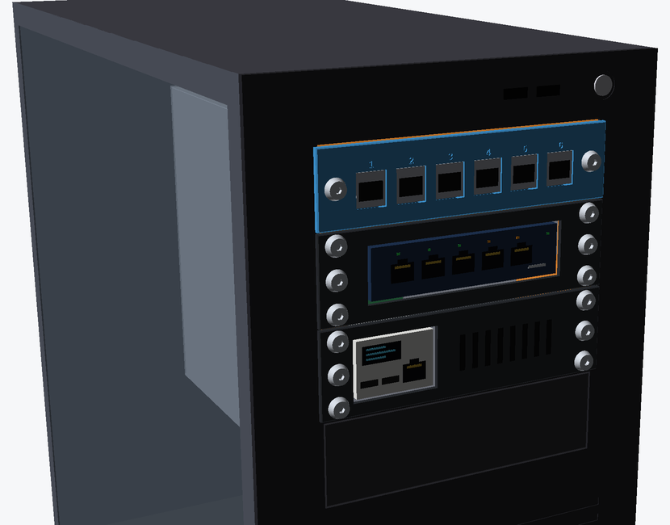

# bay2rack — bahía de 5,25" → mini rack de 6"

*[Read in English](README.md)*

Adaptador paramétrico en OpenSCAD que se atornilla a los agujeros laterales estándar de una o
varias bahías de 5,25" y las convierte en un **mini rack de 6"**. Así los accesorios de 6"
(switches, patch panels, bandejas…) se montan directamente en la caja del PC. El espacio que sobra en la pila de bahías se puede
convertir en un **patch panel de 6 keystones integrado**.



Evolución del post original
[6" mini rack switch + patch panel in a 5.25" bay](https://www.reddit.com/r/minilab/comments/1vr8vc1/6_mini_rack_switch_patch_panel_in_525_bay/).

> **[Abre el generador web](https://abarriuso.github.io/bay2rack/)**: configúralo, previsualízalo en 3D (montado en una torre,
> con la tornillería) y descarga el STL, todo en el navegador. No hay que instalar nada.
>
> **¿Solo quieres imprimir?** Todas las variantes están ya generadas en [`stl/`](stl/README.md), con la tornillería que necesita cada una.
> Imprime primero las [piezas de prueba](stl/README.md#tests).

---

## El problema de la altura

Una bahía de 5,25" mide 41,53 mm de alto y las bahías apiladas se repiten cada ~43,18 mm.
Una U de rack mide 44,45 mm. Por eso **N bahías nunca alojan N U dentro del hueco**, y el déficit crece 1,27 mm por cada bahía:

| Bahías | Alto del hueco | Flush (dentro) | Zona libre | Overhang (N U) | Los paneles sobresalen |
|------:|------:|------:|------:|------:|------:|
| 1 | 41,1 mm | 0U | 41,1 mm | 1U | +3,3 mm |
| 2 | 84,3 mm | 1U | 39,9 mm | 2U | +4,6 mm |
| 3 | 127,5 mm | 2U | 38,6 mm | 3U | +5,9 mm |
| 4 | 170,7 mm | 3U | 37,3 mm | 4U | +7,1 mm |
| 5 | 213,9 mm | 4U | 36,1 mm | 5U | +8,4 mm |
| 6 | 257,0 mm | 5U | 34,8 mm | 6U | +9,7 mm |

El diseño lo resuelve con **un único modelo paramétrico** en vez de un modelo distinto para cada número de bahías.

## Variantes

Dos elecciones independientes dan cuatro familias, y cada una está disponible para 1–4 bahías:

| | **Flush**: N−1 U + zona libre, no sobresale nada | **Overhang**: N bahías = N U |
|---|---|---|
| **Frontal plano**: marco plano detrás de los paneles | `plate-flush`: la zona libre lleva un **relleno intercambiable** (patch de 6 puertos, rejilla o tapa ciega) | `plate-overhang`: el marco es unos mm más alto que el hueco |
| **Frontal bisel**: el contorno exacto de biseles de unidades de 5,25" apiladas | `bezel-flush`: enrasado con el frontal de la caja como una unidad original, con el patch panel cortado en el bisel | `bezel-overhang`: el bisel sigue enrasado y solo los paneles sobresalen sobre el frontal |


Usa el frontal plano cuando el frontal de tu caja sea plano a la altura de las bahías. Si la caja tiene un
frontal de plástico que sobresale de la chapa, usa el bisel y ajusta `bezel_depth` a lo que sobresale ese frontal.

Otros ajustes: `units_override`, `overhang_align` (center/top/bottom), `spare_pos` (top/bottom/split)
y el relleno de la zona libre (`keystone`, `vent`, `cable`, `led`, `label` o `blank`).
El relleno puede ser `separate` (panel atornillado en el mismo plano que los accesorios) o `integral` (cortado en el marco).

## Keystones

El patch panel admite de 1 a 12 puertos (añade filas automáticamente) con números grabados opcionales.
`ks_style` elige el alojamiento:

- **`metal`** (por defecto) es la celda para **keystones metálicos / apantallados**, replicada del adaptador
  original. Tiene una boca frontal de 15 × 16,5 mm, rampa para la patilla, una cavidad de 24,3 mm y labios traseros que retienen el conector.
  Mide 9,5 mm de fondo, con paredes de 2 mm y un paso de 20 mm. Todas las cotas son parámetros (`ksm_*`).
- `standard` es un hueco simple de 14,9 × 16,4 mm en una placa de 2 mm, para keystones de plástico.


## Estándar de rack

No existe un estándar oficial de 6", así que el proyecto aplica **las reglas del mini rack de 10" a un ancho de 6"**:

- Paneles de 152,4 mm (6")
- **134,925 mm entre agujeros**: el mismo margen de 8,74 mm del borde al agujero que el estándar de 10" (panel de 254 mm, agujeros a 236,525 mm)
- Patrón vertical EIA-310 (6,35 / 22,225 / 38,1 mm en cada U) y 1U = 44,45 mm
- Tornillos M6, 10-32 o 12-24, con M6 por defecto

Si tus accesorios son distintos, usa `rack_std = custom`.

## Tornillería

| | Opciones |
|---|---|
| Tornillo de rack | M3, M4, M5, M6, 10-32, 12-24 |
| Cabeza | botón (ISO 7380), allen cilíndrica (ISO 4762), avellanada (ISO 10642, añade avellanado a los paneles), alomada (ISO 7045) |
| Fijación de rack | inserto térmico, autorroscante, tuerca hexagonal, tuerca cuadrada lateral, canal continuo de tuercas cuadradas (tornillos a cualquier altura) |
| Tornillo de bahía | M3 o 6-32, con inserto térmico, autorroscante, tuerca hexagonal o agujero pasante + tuerca suelta |
| Ajustes finos | `rack_insert_d/l`, `bay_insert_d/l` para tus insertos; `rack_screw_len`, `bay_screw_len` (0 = automático) |

El modelo **elige la longitud de tornillo estándar adecuada**, métrica o imperial. Para ello usa el
grosor de las orejas del accesorio, el grosor de la chapa de la caja y el tipo de fijación, y avisa si no
cabe ninguna. Cada render muestra la lista de materiales:

```
BOM | rack accessories: 12 x M6 x 12 button head  +  12 x M6 heat-set insert (hole 8 x 12.7 mm)
BOM | filler panels: 2 x M6 x 12 button head  +  2 x M6 heat-set insert (hole 8 x 12.7 mm)
BOM | drive bay: 6 x M3 x 5 pan head  +  6 x M3 heat-set insert (hole 4.2 x 5.7 mm)
```

La previsualización dibuja los tornillos, insertos y tuercas en su sitio (`show_hardware`). `explode` separa las piezas
y `section` corta el modelo para ver cada fijación dentro del plástico.


## Estándar de bahía

Por defecto se sigue SFF-8551 / EIA-741 (dispositivos de 5,25"): 146,05 mm de ancho, 41,53 mm de alto,
bisel de 148 × 42,3 mm y agujeros laterales M3 a 10 mm sobre la base de cada bahía y a 47,4 mm del frente.
El agujero trasero a 126,65 mm y la segunda fila a 21,84 mm son opcionales. **Cada caja es distinta, así que comprueba estas cotas**
con la pieza `test_bay`. Puedes ajustarlas con `bay_hole_offset` / `bay_hole_slot` o usar `bay_std = custom`.

## Impresión

- Los STL ya vienen orientados **con la cara frontal sobre la cama**. Las paredes y los postes crecen en vertical, y los techos de las
  ventanas y los refuerzos de los tornillos tienen forma de gota a 45°, así que **no hacen falta soportes**.
- Se recomienda PETG o ABS/ASA dentro de una caja caliente; el PLA sirve si la caja está fresca.
- 3–4 perímetros y 20–30 % de relleno.
- La versión de 3 bahías ocupa 148 × 128 mm en la cama y mide unos 66–70 mm de alto.

<p align="center"></p>

## Personalizar

- **Generador web:** [abarriuso.github.io/bay2rack](https://abarriuso.github.io/bay2rack/) ejecuta OpenSCAD compilado a
  WebAssembly en el navegador. Tiene los mismos parámetros que el Customizer, enlaces para compartir, la lista de materiales
  y descargas en STL o 3MF con colores. El código está en `web/` (Vite + pnpm); `corepack pnpm --dir web dev` lo arranca en local.

- **Customizer de OpenSCAD:** abre `src/bay2rack.scad` y ve a *Window → Customizer*. Cada variante es un preset del
  desplegable. F5 previsualiza (el adaptador aparece montado en una torre, `case_view`) y F6 renderiza.
- **Línea de comandos:**
  ```bash
  openscad -o adapter.stl -D 'part="adapter"' -D bays=3 -D 'front_style="bezel"' src/bay2rack.scad
  ```
- **Regenerarlo todo:** `python scripts/build.py` rehace los presets, todos los STL y `stl/README.md`.
  `python scripts/render_docs.py` rehace las imágenes.

Cada render muestra una línea resumen, la lista de materiales y un `WARNING`/`NOTE` cuando los tornillos, insertos o rellenos no caben.

## Estructura del repositorio

```
src/bay2rack.scad        todos los parámetros (abre este)
src/bay2rack.json        presets del Customizer (generados)
src/lib/
  standards.scad         tablas de tornillos, insertos y tuercas, longitudes estándar
  config.scad            medidas derivadas, comprobaciones, lista de materiales
  util.scad              utilidades de geometría
  fills.scad             keystones (metálico / estándar), rejilla, pasacables, LED, etiqueta
  adapter.scad           fijaciones de rack, guía de bahía, marco frontal
  panels.scad            rellenos, paneles de rack, piezas de prueba
  preview.scad           tornillería, cortes y torre de PC (solo previsualización)
scripts/build.py         tabla de variantes -> presets + stl/ + stl/README.md
scripts/render_docs.py   imágenes del README
web/                     visor y generador web (GitHub Pages)
stl/<familia>/<variante>/  STL listos para imprimir, ver stl/README.md
docs/img/                imágenes del README
```

## Licencia

[CC BY-NC-SA 4.0](LICENSE): puedes compartirlo y modificarlo citando al autor y con la misma
licencia, pero **no para uso comercial** sin permiso. Para licencias comerciales, contacta con el autor.
