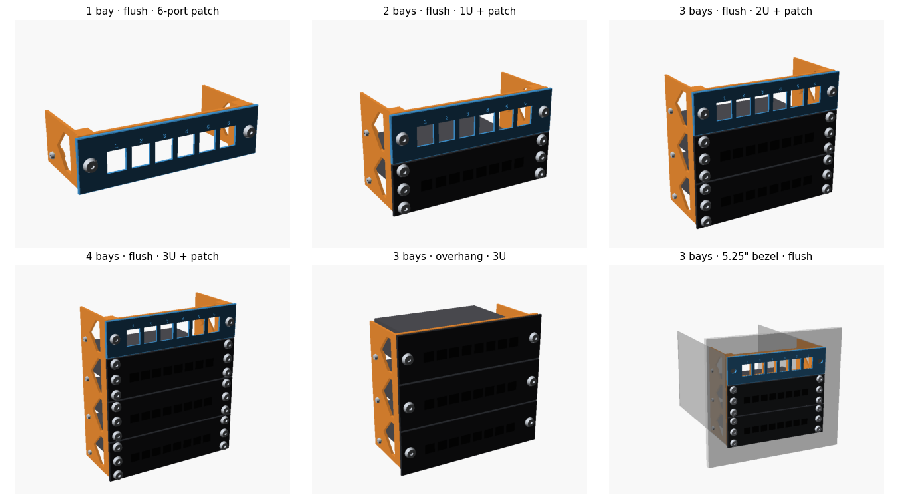

# bay2rack — 5.25" drive bay → 6" mini rack

*[Leer en español](README.es.md)*

A parametric OpenSCAD adapter that screws into the standard side holes of one or more
5.25" drive bays and turns them into a **6" mini rack**, so 6" rack accessories (switches,
patch panels, shelves…) mount straight into a PC case.

The space a bay stack leaves over can become a **built-in 6-port keystone patch panel**.



Evolution of the original
[6" mini rack switch + patch panel in a 5.25" bay](https://www.reddit.com/r/minilab/comments/1vr8vc1/6_mini_rack_switch_patch_panel_in_525_bay/).

---

## The height problem

A 5.25" bay is 41.53 mm tall and stacked bays repeat every ~43.18 mm. A rack unit is 44.45 mm.
So **N bays never hold N U inside the stack**. The deficit grows by 1.27 mm per bay:

| Bays | Stack height | Flush (inside the stack) | Spare zone | Overhang (N U) | Panels stick out |
|-----:|-------------:|-------------------------:|-----------:|---------------:|-----------------:|
| 1 | 41.1 mm | 0U | 41.1 mm | 1U | +3.3 mm |
| 2 | 84.3 mm | 1U | 39.9 mm | 2U | +4.6 mm |
| 3 | 127.5 mm | 2U | 38.6 mm | 3U | +5.9 mm |
| 4 | 170.7 mm | 3U | 37.3 mm | 4U | +7.1 mm |
| 5 | 213.9 mm | 4U | 36.1 mm | 5U | +8.4 mm |
| 6 | 257.0 mm | 5U | 34.8 mm | 6U | +9.7 mm |

The design handles this with **one parametric file** instead of one model per bay count.

## Fit modes

| `fit` | What you get | Trade-off |
|---|---|---|
| `flush` (default) | N−1 U plus a 35–41 mm **spare zone**. Nothing sticks out of the bay stack. | You lose almost one U, but you get it back as a patch panel, vent or label. |
| `overhang` | N U. The rack panels are a few mm taller than the stack and overlap the case front. | Device bodies must still fit through the stack opening. |

`units_override` forces any U count. `overhang_align` (center/top/bottom) and `spare_pos`
(top/bottom/split) control where the extra height goes.

## Front style

| `front_style` | Description |
|---|---|
| `plate` (default) | A flat 148 mm frame behind the rack panels. |
| `bezel` | **The exact outline of stacked 5.25" drive bezels.** It is 148 × 42.3 mm per bay, with cosmetic grooves between bays, and is as deep as a drive bezel (`bezel_depth`). It slips into the case front opening and sits **flush, like an original drive**. Use `filler_mode = integral` for a completely flush face. |

Bezel mode works with both fit modes. In `overhang` the frame keeps the bezel size and only the
rack panels overlap the case front.

## Spare-zone fills

`spare_fill` / `spare_fill_2` (split mode) / `panel_fill`:

- `keystone`: N keystone ports (default 6, 1–12, auto rows), optional numbered labels
- `vent`: horizontal ventilation slots
- `cable`: rounded pass-through slot
- `led`: diffuser slot with an LED-strip channel behind it
- `label`: engraved text
- `blank`

`filler_mode = separate` (default, modular) makes the fill a screw-on panel in the same plane
as the rack accessories, so you can swap it later. `integral` cuts the fill straight into the frame (one print).

## Rack standard

There is no official 6" standard, so this project uses **the 10" mini rack rules on a 6" width**:

- 152.4 mm (6") panels
- **134.925 mm hole spacing**: the same 8.74 mm edge-to-hole inset as the 10" standard (254 mm panel, 236.525 mm spacing)
- EIA-310 vertical hole pattern (6.35 / 22.225 / 38.1 mm in each U), 1U = 44.45 mm
- M6, 10-32 or 12-24 screws, with M6 as the default

If your gear differs, set `rack_std = custom`.

## Hardware

All hardware is selectable:

| | Options |
|---|---|
| Rack screw | M3, M4, M5, M6, 10-32, 12-24 |
| Head | button (ISO 7380), socket (ISO 4762), countersunk (ISO 10642, adds countersinks to panels), pan (ISO 7045) |
| Rack fixing | heat-set insert, self-tapping, hex nut trap, square nut side slot, sliding square-nut channel (screws at any height) |
| Bay screw | M3 or 6-32, with heat-set insert, self-tapping, hex nut or clearance + loose nut |
| Overrides | `rack_insert_d/l`, `bay_insert_d/l` for your inserts; `rack_screw_len`, `bay_screw_len` (0 = auto) |

The model **chooses the right standard screw length**, metric or imperial. It uses the accessory
ear thickness, the case sheet thickness and the fixing type, and warns when nothing fits.
Every render prints a **bill of materials**, for example:

```
BOM | rack accessories: 12 x M6 x 12 button head  +  12 x M6 heat-set insert (hole 8 x 12.7 mm)
BOM | filler panels: 2 x M6 x 12 button head  +  2 x M6 heat-set insert (hole 8 x 12.7 mm)
BOM | drive bay: 6 x M3 x 5 pan head  +  6 x M3 heat-set insert (hole 4.2 x 5.7 mm)
```

### Previewing the hardware

In the assembly preview, screws, inserts and nuts are drawn in place (`show_hardware`).
`explode` pulls everything apart, and `section` cuts the model open through a rack hole row, a rack hole
column or the bay screws so you can see each fixing inside the plastic.


## Bay standard

The defaults follow SFF-8551 / EIA-741 (5.25" devices): width 146.05 mm, height 41.53 mm,
bezel 148 × 42.3 mm, M3 side holes 10 mm above each bay's bottom and 47.4 mm from the front.
A rear hole at 126.65 mm and a second row at 21.84 mm are optional. **Cases vary, so verify these
numbers.** Use `bay_hole_offset` / `bay_hole_slot` to adjust, or set `bay_std = custom`.

## Before printing the full adapter

Pre-built test STLs (default settings) are in `stl/tests/`.

1. `test_bay`: one corner with the bay holes, plus the front/bezel. Check that it screws in and sits flush.
2. `test_rack`: a thin bar with two rack fixings. Check it against a real 6" accessory.
3. `test_keystone`: one keystone cut-out. Check that the jack clips in firmly.

## Printing

- Print every part **front face down**. Walls and posts rise vertically, and window roofs and screw
  bosses are 45° teardrops, so **no supports** are needed.
- PETG or ABS/ASA is recommended inside a warm case; PLA works for cool cases.
- 3–4 perimeters, 20–30 % infill.
- 3 bays print at 148 × 128 mm on the bed. Part height is about 66–70 mm.

## Usage

- **OpenSCAD Customizer:** open `src/bay2rack.scad` and use *Window → Customizer*. The presets
  from `src/bay2rack.json` appear in the dropdown. Press F5 to preview and F6 to render.
- **Command line:**
  ```bash
  openscad -o adapter.stl -D 'part="adapter"' -D bays=3 -D 'front_style="bezel"' src/bay2rack.scad
  ```
- **All presets:** `scripts/build.sh` exports every preset to `stl/<preset>/`.

Every render prints a summary line, the BOM and a `WARNING`/`NOTE` whenever the screws,
inserts or fills don't fit.

### Presets

| Preset | Contents |
|---|---|
| `1bay-patch6` | A single bay turned into a 6-port keystone patch panel |
| `2bay-flush-1U-patch6`, `3bay-flush-2U-patch6`, `4bay-flush-3U-patch6` | Flush, with a 6-port patch panel in the spare zone |
| `3bay-flush-2U-vent` | Flush, with vents in the spare zone |
| `2bay-bezel-1U-patch6`, `3bay-bezel-2U-patch6` | Exact 5.25" bezel, flush with the case front, integral patch panel |
| `3bay-bezel-overhang-3U` | Bezel frame, 3U of panels overlapping the case front |
| `2bay-overhang-2U`, `3bay-overhang-3U` | Plate frame, N U |
| `panel-1U-patch6`, `panel-1U-vent`, `panel-2U-patch12` | Standalone 6" rack panels |

## Layout

```
src/bay2rack.scad    parametric model (single file, Customizer-ready)
src/bay2rack.json    parameter presets
scripts/build.sh     batch STL export
stl/                 pre-built STLs for the presets
docs/img/            renders
```

## Roadmap / ideas

- [ ] Verified hole spacings for commercial 6" racks (PRs with measurements welcome)
- [ ] Shelf / tray part for devices without rack ears
- [ ] Tool-less clip option for cases without side screws
- [ ] Brush or grommet cable fill

## License

[CC BY-NC-SA 4.0](LICENSE): you may share and remix it with attribution, under the same
license, and **not for commercial use** without permission. For commercial licensing, contact the author.
